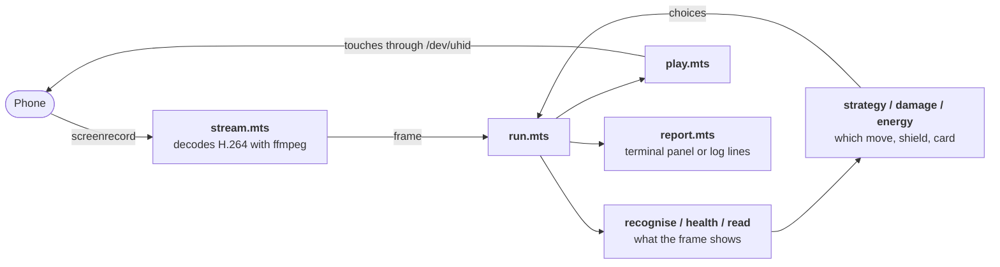

# Trainer battles

`pnpm battle` plays Pokémon GO's trainer battles on an Android phone over `adb`: Team Leader training, or GO Battle
League against other trainers. How to run it is in the [root README](../../../README.md#trainer-battles) and in the
usage at the top of [`scripts/battle.mts`](../../../scripts/battle.mts). This page is for working on it: how it is put
together, and the strategy it plays by.

## How it works

A battle turns every half second, and a screenshot over `adb` takes 0.8–1.9s, so the bot cannot look at the game the way
`pnpm inventory` does. It watches the screen as video instead, decides something about every frame, and acts with taps
and swipes. The menus between battles are slower and change rarely, so those are read off full screenshots.

### Watching the screen

- **[`stream.mts`](stream.mts)** runs `screenrecord` on the phone, which sends H.264 at about 30 frames a second, and
  decodes it with `ffmpeg` into the same `Image` the inventory readers take. `Screen` keeps one recording going after
  another, since `screenrecord` stops after 180s, and always answers the latest frame.
- **How far behind the phone a frame arrives:** a median of 51ms (p90 57ms, p99 88ms) on a Pixel 4 XL showing the map,
  which redraws at 30 frames a second. That was 85ms (p90 89ms) while `ffmpeg`'s `rawvideo` encoder held each frame
  until the next. It was measured with `screenrecord --bugreport`, which stamps every frame with the time the phone
  composited it. The stamps were read off about 600 decoded frames and set against when each arrived, the phone's clock
  taken against the computer's from the quickest of 40 round trips of `echo $EPOCHREALTIME` through a held `adb shell`,
  to within 0.3ms. The stamp costs the phone a drawing pass of its own, so the plain stream may be a little quicker.
- **What is left of it:** about a frame is `ffmpeg` waiting for the next picture to begin, since raw H.264 doesn't mark
  where a picture ends. On a screen that keeps moving that is 33ms, but a change the screen then holds still isn't seen
  until something next moves, since `screenrecord` sends nothing for a still screen. Cutting it needs a source that
  frames its pictures, as scrcpy's server does with each packet's size. `adb`'s reads don't: 13 of 612 carried the tail
  of a picture, up to 5ms after its start, so a marker added after each read would cut one picture in fifty in two.
- **[`layout.mts`](layout.mts)** places a position on a phone of any shape. The game sizes things by the screen's width
  and pins each piece at a fraction of the height, its _anchor_: 0 for the top, 1 for the foot, something in between for
  a piece inside a panel. So a position down the screen is written as its anchor and a number of the screen's widths
  from it, which is the same on every phone, and no phone's shape is the reference. Anchors are measured on both a Pixel
  8 Pro and a Pixel 4 XL.

### Reading a frame

Everything read per frame is done by colour samples, which are cheap. OCR is slower, about 220ms a read, so it is kept
for text and done every few seconds.

- **[`recognise.mts`](recognise.mts)** says which part of a battle a frame shows: `battle`, `charged` (a charged-move
  button is lit), `shield` (the Protect Shield prompt), `switch` (the prompt after a faint) or `other` (a charged move
  playing, a banner, the result, a menu). It also reads which charged-move buttons are lit, each side's shields from the
  hexagons in the HUD, each side's Pokémon left from the three Poké Balls beside them, and the countdown the opponent's
  charged move puts up at the top of the screen while its minigame plays.
- **[`health.mts`](health.mts)** finds each side's HP bar. The camera moves both bars around the screen, so they are
  searched for: a strip of the fill's green, yellow or red with the bar's outline around it. Where a strip starts across
  the screen says whose it is.
- **[`typing.mts`](typing.mts)** reads each side's types from the round icons above its panel, one per type: ours from
  the left edge, the opponent's from the right. Each icon is told by its colour against the game's own icon for each
  type, and from the empty sky beside a single type by the white emblem on it. This is what tells a species' forms
  apart, which the name alone can't.
- **[`read.mts`](read.mts)** reads text with Tesseract:
  - **The HUD:** both names along the top and the CP beside each. Our name is the species unless the Pokémon has a
    nickname.
  - **The buttons:** the charged move printed under each one, matched to the moves our species can hold.
  - **The banner:** the line a charged move puts up as it lands, `Tyranitar used Crunch!`. This is the only direct view
    of the opponent's moves.

### Acting on a frame

- **[`play.mts`](play.mts)**' `Player` turns a frame's state into an action: a swipe, a tap or a wait. A swipe across
  the field fires a fast move, about six a second. A charged move is tapped the moment the chosen button lights; with
  none chosen, whichever lit first. A state must hold for a few frames before it is answered, because a prompt sliding
  in matches for a frame or two on its own. A tap is repeated each second its button or prompt stays up. A charged
  move's throw waits for the fast move under way, its button lit meanwhile, but a dropped tap looks the same, and a
  Pokémon low on HP can faint while it waits. Nothing is swiped for 0.7s after a charged-move tap, since a swipe
  straight after one could cost the throw. A bench card to switch to is tapped ahead of a lit move, since the switch is
  made to keep that move's energy.
- **Sending them** goes through one `adb shell` held open for the run ([`adbHeld`](../inventory/adb-cli.mts)), not a
  fresh `adb` process for each tap and swipe as `pnpm inventory` uses, and to a touchscreen of the run's own
  ([`touchscreen.mts`](../inventory/touchscreen.mts)) rather than through `input`, which starts a Java runtime on the
  phone for every command. The shell makes it a virtual HID device through `/dev/uhid` and writes each touch to it as a
  report with its builtin `print`, a swipe as one command whose moves the phone paces with `read -t`. The phone's own
  touchscreen can't be written: SELinux refuses the shell `/dev/input/event*`, `sendevent` included. Over a Training
  battle on a Pixel 4 XL, the time a swipe takes beyond its own 80ms fell from a median of 30ms (p95 42ms) with `input`
  to 12ms (p95 19ms), and a tap's from 23ms to 3ms. Part of the tail was the held shell answering each command in two
  writes, the second waiting up to 40ms on the `adb` client's delayed ACK of the first. The shell exiting, as it does
  when the phone is unplugged, stops the run with the command it was sending, cut short, as
  `adb shell print -nu3 '\0014\0000\0000\0000\0010\0000\0001\0001\0000\00…: adb shell exited; is the phone still connected?`,
  and a phone that stops answering does so after 30s with `no answer after 30s`.
- **[`minigame.mts`](minigame.mts)** finds the charged-move minigame's bubbles. They are discs of the thrown move's type
  colour, read off the game's own icon for the type and washed towards white. Each chain of them is swiped along its
  length. Where none are found, rows are swept instead. `Player` swipes the minigame from a charged-move tap until the
  throw plays, and from when the run finds a throw [playing](#the-run-loop) that no tap began, as where the opponent's
  move came first.

### Between battles

- **[`menus.mts`](menus.mts)** reads the screens between battles off full screenshots and says where to tap.
  - **Training:** there is no rematch, so it goes round every time: the result's ✓, the leader on the Battle tab,
    BATTLE, the league, USE THIS PARTY.
  - **GO Battle League:** BATTLE on its card, the welcome before a set, the league chooser, the party (optionally a
    saved party named by `--party`, searched for along the carousel), matchmaking, and NEXT BATTLE. A set's reward is
    left to be collected by hand.
  - **From the map:** the Poké Ball, then BATTLE on the main menu.
  - **How it reads:** colour where that settles it, as for the leaders' portraits and the green buttons, and OCR for
    screens told apart by their words. GO Battle League's party screen also states the league's CP cap.
- **[`party.mts`](party.mts)** says which species each party card holds by silhouette, by laying each form icon's
  outline over the card. The card's own name is no help, since it may be a nickname. Silhouettes rather than colours,
  because a shiny is drawn in colours its icon doesn't have.

### The run loop

**[`run.mts`](run.mts)** ties it together, one frame at a time:

1. **Recognise the frame.** On the first non-`other` frame of a battle, everything about the last battle is reset.
2. **Read cheap things every frame:** shields, Pokémon left and HP bars. A bar of the opponent's reading fuller than
   before means a new Pokémon, HP never coming back, so its name and CP are dropped and read again at once.
3. **Read text every 3s,** or at once after a switch: names, CPs and our move labels, and with them each side's type
   icons. The read runs beside the battle rather than holding it up, the fight swiped and prompts answered meanwhile,
   and is merged on the first frame after it is back. One begun before a newcomer of theirs, a faint or switch of ours
   or the next battle is of the Pokémon before, and is dropped. While a read is under way, no lit button is thrown if
   any is unnamed, unless a named one is to go now, a finish or a throw for fear of fainting: that covers ours sent in
   after a faint, read at once, but not one switched in from the bench, whose first read waits 2s. After the opponent's
   throw, a shield prompt or its countdown, the banner is looked for for 8s, beside the battle too.
4. **Update the opponent's energy count** from our bar ([below](#the-opponents-energy)), and what our hits take off its.
5. **Decide:** whether a shield would be taken, which button to throw if any, which card to send in after a faint, and
   whether to switch when the opponent does. That is `strategy.mts`, `damage.mts` and `energy.mts`.
6. **Act:** hand the state and the decisions to `Player`, then perform its swipe, tap or wait. A charged move tapped is
   logged as thrown, `threw Fly`, and its stat changes counted only once it plays. In the user's GO Battle League
   recordings, an opponent throwing on the same turn could drop our tap, its button lighting again with the energy kept,
   or hold our throw back until after theirs, its minigame then coming with no tap. So a throw is taken to be playing
   once the fight has shown none of our buttons lit for 3.5s, as its minigame does throughout: every minigame there ran
   5.1s or more, and nothing else after a tap more than 2.4s. Its bubbles are no sign, Fly's being found on its own lit
   button and on the sky. Its button lit again for 1s and not tapped, once the opponent's move has come between, is the
   tap dropped, logged as `Fly not thrown: its button lit again with no minigame`; tapped again, it is the same throw
   retried. A faint or a switch of ours before it plays drops it too.
7. **Off the battle:** once a screen has read `other` for 1.5s, take a screenshot and read it as a menu, again beside
   the battle. If nothing at all has been recognised for 20s, stop with `Lost`, keeping the last frames for
   `--keep-frames`. A battle off its field for 3s or more, through the minigame, a prompt or a charged move playing, is
   told once it comes back, how long and what showed:
   `off the battle for 10.1s: the minigame for our Shadow Sneak (5.1s), then the charged move playing (5.0s)`. A stretch
   the battle never comes back from, its end, is not.

`run` is driven through a `Phone` (latest frame, screenshot, tap, swipe) and a `Clock`, never `adb` directly, so tests
stand in a scripted phone that plays committed frames as scenes.

**[`report.mts`](report.mts)** is how a run tells of itself: events (a tap, a throw, a shield taken and why, a faint)
and a status sent every frame. On a terminal, `live` draws a fixed full-screen panel with our side on the left and the
opponent's on the right. Where the terminal speaks the Kitty graphics protocol, as Kitty, Ghostty and WezTerm do, the
phone's latest frame is drawn down the panel's left edge at full height, so long as the table beside it still has 80
columns and `--no-graphics` doesn't leave it out. [`kitty.mts`](kitty.mts) draws it, passing each frame as a temporary
file the terminal reads, and asks the terminal first, so one that can't read the file, such as a remote one, draws no
picture rather than a broken one. Where stderr isn't a terminal, `plain` writes lines instead, which is what `--verbose`
gives there.

The phone is drawn ten times a second rather than every frame. At 30 a second Ghostty fell behind reading the 1.2 MB
files, and the run sat blocked writing the panel to it, for 181ms at the longest. Ten a second costs the run itself
about 0.8ms a picture, under 1% of a core, but the terminal draws each on the graphics processor. On a Ryzen 5 7640U
laptop that took the chip from 20W to its 33W limit, and through the second half of a 208s battle its cores ran at 1.5
GHz rather than 2.7 GHz. The run's own work took half as much CPU time again, it stood still for up to 235ms at a time,
and the slowest 1% of its actions came 560ms to 600ms after their frame rather than 250ms. One picture a second cost
nothing measurable. `--no-graphics` rules the picture out when chasing a timing problem.

### Game data

- **The game master,** from [`../inventory/download.mts`](../inventory/download.mts): every form's types, stats and move
  pool, and every move's trainer-battle power, energy, duration in turns, and stat changes. It is downloaded and cached
  for a week; tests read the vended [`../inventory/fixtures/game-master.json`](../inventory/fixtures/game-master.json).
- **[`meta.mts`](meta.mts)** reads [PvPoke](https://pvpoke.com)'s rankings for the league being played in GO Battle
  League. It matches `--league` to PvPoke's cup by title; a cup PvPoke doesn't list falls back to its league's open
  rankings. For each species it gives the moves its players run and the recommended fast move. A species' forms and
  shadow are merged, since the HUD names only the species; the type icons narrow the forms afterwards, but nothing on
  screen tells a shadow apart. If nothing matches, or PvPoke can't be reached, every move stays allowed for. Training
  never uses it.

### Testing

Each reader is tested against committed frames in [`fixtures/`](fixtures/), PNGs and H.264 clips stored with Git LFS,
from both a Pixel 4 XL and a Pixel 8 Pro. Each threshold in the code is quoted beside the frames it was measured on.
`run.test.mts` plays whole battles through a scripted phone. New fixtures come from `pnpm battle record`. Before a
capture is committed, the account's trainer names and the Nearby Battle QR code must be filled in solid (see
[`CLAUDE.md`](../../../CLAUDE.md)).

## Gameplay strategy

The bot plays with far less information than a person watching the screen. Most of the strategy is about filling the
gaps safely.

**What it can see:**

- **The HUD:** each side's species and CP, its types, HP bar, shields and Pokémon left.
- **Our side:** which of our charged-move buttons are lit, and the moves under them.
- **Banners:** the opponent's charged moves as they land.

**What it can't see:**

- either side's IVs or level, or our own energy
- the opponent's energy or fast move
- the opponent's charged moves before they're thrown
- whether a move's chance-based stat change actually happened

### Fast moves

It swipes for fast moves continuously, about six a second, so no turn goes unused.

### Which charged move to throw

**Worth.** A move's worth is its power × STAB × its effectiveness against the opponent ([`strategy.mts`](strategy.mts)).
Stats, level and the trainer-battle bonus are the same for both of one Pokémon's moves against one opponent, so they
cancel out. Where a species' forms differ in type, as a Galarian Moltres does from a Kantonian one, the type icons above
each side's panel say which form it is ([`typing.mts`](typing.mts)). Where they weren't read, or show a typing no form
of the species has, a move is valued against the typing it does worst against.

**Stat changes.** Worth is adjusted for the stat stages a move may move, each priced as if it touched one more hit of
the same size, and weighted by its chance. So Close Combat's certain −2 to its user's defense halves its worth, and
Ancient Power's one-in-ten buff adds about 5%.

**On our last hit,** when we have no shield left and the opponent's next charged move would faint us, changes to our own
stats count for nothing, since there's no next hit for them to matter on.

**Worth per energy.** Once the opponent's shields are gone, it throws the move worth the most for each point of energy
it costs, and of two worth as much, the cheaper, which fires sooner. With no shield to take a throw, energy is all that
limits the damage dealt, which over a fight comes to the energy gained × the worth of each point. Holding for a bigger
move worth no more per energy gains nothing, and risks fainting with the energy stored or the opponent switching out. So
Snorlax throws Body Slam, 78 for 40 energy or 1.95 a point, rather than hold for Earthquake, 120 for 65 or 1.85, against
an opponent that takes both neutrally. It holds for Earthquake into an Ampharos, which Earthquake hits super
effectively, or a Giratina, which resists Body Slam twice over. In the 12 Ultra League battles the user recorded, they
threw Body Slam or Dynamic Punch at an unshielded opponent as soon as it lit rather than hold for Earthquake or Hyper
Beam: worth per energy matches 8 of their 10 such choices, where worth alone matches 3, a move thrown again at the same
opponent counting as the one choice. Snorlax's two Body Slams at an unshielded Garchomp are one, and Garchomp fainted
without throwing a charged move in its 29s out. The two choices that don't match were both against a Sylveon: holding
Body Slam for Earthquake with Snorlax at 20%, and throwing Dynamic Punch, twice, where Hyper Beam gets more per energy.

**Baiting.** While the opponent still has shields, it throws its _cheapest_ move, to draw a shield that the move worth
the most per energy would otherwise be thrown into. A bait costing no more than **10** energy less than the move worth
the most per energy isn't worth the shield it might not draw, so that move goes instead, logged as
`threw Flamethrower: not baiting: Ancient Power costs only 10 less than Flamethrower`.

**Holding energy.** Once it has picked a move, it waits for that button to light, even while a weaker move is already
ready, except when it may not live that long: with no shield to take, and the opponent's counted energy (with the
[one-hit allowance](#the-opponents-energy)) affording a move that would faint us, it throws whichever lit button is
worth the most now, whatever it costs, even while baiting. A shield drawn or damage dealt beats fainting with the energy
stored, and a throw that may be the last is worth what it hits for. A lit button whose move wasn't read isn't weighed,
and a faint feared only for something unread doesn't count, since only the count says a fainting move can come now. It
is logged as `threw Ancient Power: Iron Head would faint us, 56 energy affords it; not holding for Flamethrower`. Where
the move picked is lit as well, as Body Slam is when Earthquake lights beside it, the throw passes it over rather than
holds for it, logged as `threw Earthquake: Psyshock would faint us, 40 energy affords it; worth more than Body Slam`.

**Finishing.** Ahead of both, a ready move that would finish the opponent once its shields are gone is thrown at once,
whatever the move held for, the cheapest of two that would ([`damage.mts`](damage.mts)'s `finisher`). It wins over a
throw for fear of fainting, since the opponent gone can't land the hit we feared, where the one lit worth the most might
leave it standing. Its damage is judged as for shielding [below](#when-to-shield), with our attack and their defense
stages, at the least it would take of any form either side could be. It must take nine tenths of that at least 2 points
more than the opponent's bar shows, for the builds being guesses and the bar wandering a point or two frame to frame.
Anything unknown leaves the move held for, the opponent's CP unread included. The throw is logged with the reason, such
as `threw Hydro Cannon: would finish Giratina at 12%`.

**Not overkilling.** Ahead of all of these, a throw about to go is held, every charged move with it, where our fast
moves alone will finish an opponent with another to come before it can throw ([`energy.mts`](energy.mts)'s `spare`). The
energy then lands on the next the moment it is out: a player held Brave Bird and Fly while Galarian Moltres's fast moves
finished a Giratina at 15%, and threw Brave Bird as the Mewtwo after it landed, which won the game. Only with the
opponent's shields spent and more than one of its Poké Balls red, and only on what was measured:

- **Our hits.** What one of our fast moves takes of its bar is measured as [its on ours](#the-opponents-energy) is, the
  median clean step. No more than **4** of them may be left to finish it, with the bar's 2 points of wander: about what
  Sucker Punch needed for that Giratina.
- **Its throw.** Its counted energy must afford none of its charged moves after the fast moves of its that land
  meanwhile, plus one for a hit the count missed. Meanwhile is our hits at the longest fast move our species has, and
  never fewer of its than of ours.
- **Our survival.** Those fast moves of its, at its measured step, must leave us standing.

Anything unmeasured or unread throws as before. The hold is logged once, such as
`holding Brave Bird and Fly for the next: fast moves finish Giratina at 15%`, and an opponent switching out simply ends
it.

### When to shield

The shield prompt never names the move coming. It takes a shield only if the hardest move the opponent could be throwing
would take at least **90%** of the HP our bar shows ([`damage.mts`](damage.mts)'s `wouldFaint`). A hit we would survive
is taken, and the shield kept for one we wouldn't. The margin short of 100% allows for the HP being read off a bar and
the opponent's build being a guess.

What goes into "the hardest move the opponent could be throwing":

- **Damage, in HP.** Each side is assumed built rank 1 for the CP the HUD shows: the IV spread with the highest attack ×
  defense × HP at that CP. Rank 1 for the CP read, not for the league's cap, because a Pokémon well under the cap wasn't
  built for it. The formula is PvPoke's, with STAB, effectiveness and the 1.3 trainer-battle bonus.
- **Which moves it could have:**
  - In Training, every charged move its species can learn, except Frustration and Return.
  - In GO Battle League, only the moves PvPoke finds its players run: those used at least a fifth as often as the most
    used one.
  - Once the banner has shown both of its moves, only those two.
- **What it can afford.** Only moves costing no more than its counted energy, plus one fast move's worth for a hit the
  count missed ([below](#the-opponents-energy)).
- **Stat stages.** Their attack and our defense, as the charged moves thrown so far have moved them: ours as each of our
  throws [plays](#the-run-loop), theirs off the banners. Only changes that always happen are counted. A side's stages
  reset when its Pokémon leaves the field. A shield stops the damage, not the stat change.

**Anything unknown takes the shield:** either side's species or CP unread, a CP over the cap (so misread), our HP
unread, or the cap itself not yet known. A shield spent early costs less than a Pokémon lost. Each shield taken or kept
is logged with the reason, such as `Flamethrower would take ~45%, with 50% left, the hardest 60 energy affords`.

### The opponent's energy

Neither the opponent's energy nor its fast move is on screen, so both are counted off our own HP bar
([`energy.mts`](energy.mts)):

- **Hits.** Each of their fast moves that lands takes a step off our bar. A _clean_ step is a drop between two readings
  less than 500ms apart, too close for two hits. The median clean step is what one hit takes, so the HP lost ÷ that is
  the number of hits. That needs no guess at IVs or a shadow bonus, and missed frames don't matter, because only the
  total lost counts.
- **Which fast move.** The damage model says which of the species' allowed fast moves a step that size is, and so how
  much energy each hit gains. Before any clean step, the count uses PvPoke's recommended fast move (or, in Training, the
  one gaining energy fastest), at the smallest hit any build would land. That counts the most hits, erring towards more
  energy.
- **Throws.**
  - A shield prompt that holds for three frames counts as the opponent's throw. It's taken to be its cheapest allowed
    move until the banner names it; then the throw is settled at the named move's real cost.
  - With none of our shields left, a throw puts up no prompt, only `No Protect Shields remaining!` and the countdown at
    the top of the screen, a disc of translucent black around the seconds left. The countdown showing for three frames
    since the fight last did, in a row or not, counts as the throw instead, once only until the fight shows again, so
    that a wing across the disc for a frame or two splits no throw in two. The banner after it is read as after a
    prompt. In the user's 12 recorded GO Battle League battles, 26 throws came this way, in 10 of them, and the
    countdown read as up for each for its whole five seconds, bar three frames at most, and for nothing else.
  - If the banner names a move dearer than what was counted, the count was short, and the opponent is left with nothing.
- **Bookkeeping.**
  - Energy is kept per opponent Pokémon, including while it's switched out, and capped at 100.
  - HP lost across a prompt, the minigame, a switch or a banner isn't counted as a fast move.

The count can only run low through hits it can't see, such as one landing behind a banner or one smaller than a pixel of
the bar. The one-hit allowance covers a single miss. When the allowance still leaves no move the opponent could afford,
the count must be short, and every move is allowed for again.

### After a faint

Of the Pokémon left, it prefers one whose [banked](#banking-energy) charged move would finish the opponent the moment it
lands, judged as [finishing](#which-charged-move-to-throw) is, which comes before safety: the opponent gone, nothing of
its lands. It's logged as `its banked Fly finishes Buzzwole`. Otherwise it prefers one that none of the opponent's
allowed moves can hit super effectively. Among those, or among all of them if none is safe, it picks the one whose
hardest move hits the opponent hardest, and between equals, the first card ([`strategy.mts`](strategy.mts)'s `nextOut`).
The reason is logged, such as `the only one safe from Glaceon's moves`. A card whose species wasn't read goes in only
when its banked energy finishes the opponent, when nothing named is left, or when it is first and nothing named is safe
or hits at all.

### When the opponent switches

An opponent that switches out (rather than faints) has spent its switch timer, so it can't answer a switch of ours
straight away. If the newcomer's allowed moves can hit ours super effectively, it switches at once to a benched Pokémon
that counters it outright: safe from every one of those moves, and holding a charged move that is super effective
against every typing the newcomer's forms have ([`strategy.mts`](strategy.mts)'s `counterOf`). Of several, the one that
hits hardest; with none, it stays in. Like `nextOut`, it judges our benched Pokémon by every move their species can
learn, since their actual moves only show once they're out. Unread species never switch, and nor does one with a lit
move that would [finish](#which-charged-move-to-throw) the newcomer, since the bench is tapped ahead of a lit move, nor
one [doomed](#banking-energy) with a move lit to throw into a shield.

The bench's cards run down the right edge, in party order, without the one out or any that fainted. A tap switches at
once, with nothing to confirm, and does nothing while our own switch timer runs. Rather than model the timer, the run
reads our HUD again 2s after the tap: a CP unchanged means the tap was refused, logged as
`Latias not sent in: the switch timer is running`, and the Pokémon tapped away from is taken to still be out.

### Banking energy

A Pokémon keeps its energy on the bench, so a charged move lit as it switches out is still lit when it comes back in.
The bot can't read energy, but a lit button proves it, so each switch of ours records the moves lit as it left. In 4 of
the 11 GO Battle League battles the user recorded (10 won), a Pokémon switched out with a move ready and threw it on
coming back, about seven times in all, taking a shield or a knockout each time.

- **Escaping with it.** While the opponent switched in stays out, its switch timer spent, a Pokémon of ours it threatens
  that has a move lit and no [counter](#when-the-opponent-switches) being switched to switches to one safe from all of
  the newcomer's moves, the hardest-hitting of those ([`strategy.mts`](strategy.mts)'s `refugeOf`), logged as
  `switching to Snorlax against Granbull, banking Fly`. Not when the lit move would finish the newcomer.
- **Drawing the shield with it.** A lit move that would finish the opponent but for its shield is kept, and a benched
  Pokémon with energy banked is sent in to draw the shield (`stripperOf`), one safe from the opponent first. Where the
  one sent takes the last shield, ours is sent back in after it faints, with the finish still lit. One sent in for this
  throws rather than switching away again. Live, a Melmetal with Dynamic Punch ready for a shielded Samurott gave way to
  a Galarian Moltres, whose two banked Fly drew both shields; Melmetal came back after Moltres fainted and finished
  Samurott.
- **Spending it when doomed.** With no shield of ours left, our HP read low enough that a hit the opponent may land
  would faint us, and a shield of theirs to draw, no switch is made, the counter switch included: the move to throw,
  already lit, goes into the shield, there being little left of ours to save. The faint is feared rather than counted,
  since an opponent just switched in may carry energy banked that the count can't see: live, a Zapdos threw two seconds
  after coming back in. Logged as `staying in against Kyogre: Fly drawn into a shield before Moltres faints`. Live, that
  Fly took Kyogre's last shield, and it had none for the rest of the battle.

Neither switch is tried within 45s of a switch of ours, our switch timer running meanwhile. One the timer refuses all
the same gives the bank back, and neither is tried again for 10s.

### Knowing who is out

- **Ours:** a nicknamed Pokémon's species comes from the party screen: the lead, then whichever card was sent in. If the
  moves read under the buttons can't belong to that species, which a misread card would cause, it moves on to the next
  card that fits. A switch prompt is answered only once our Poké Balls show a faint since the last one: a dark field at
  night can match its slate panel, and was once answered with all three of ours still red.
- **Theirs:** a switch made with the HUD up shows as their HP bar reading fuller than before. Fewer Poké Balls left than
  when the last name was read means the old one fainted, logged as `Entei fainted; sent in Salamence`; otherwise it
  switched out, `switched to Sneasel`.

### What's next

The strategy still leaves some gaps:

- **Our own energy.** Reading the fill on the unlit charged-move buttons would say how far off the best move is. That
  needs fixtures cut from a recording of moves of different types filling up, against light and dark skies.
- **Throwing what's ready before fainting.** A lit move goes now once the opponent's counted energy affords a move that
  would faint us ([above](#which-charged-move-to-throw)). Still missing: fast moves wearing us down before the best move
  fills, which needs our own energy to see coming.
- **Our own fast move.** Holding for the next ([above](#which-charged-move-to-throw)) takes ours to be the longest our
  species has. Told apart by the size of our hits, as the opponent's is by its, it would hold more often.
- **Out of scope for now:**
  - Getting a throw in before the opponent's.
  - Choosing who to send in by the opponent's energy.

  Both need a model of what the opponent will _choose_, not just what it can afford.
